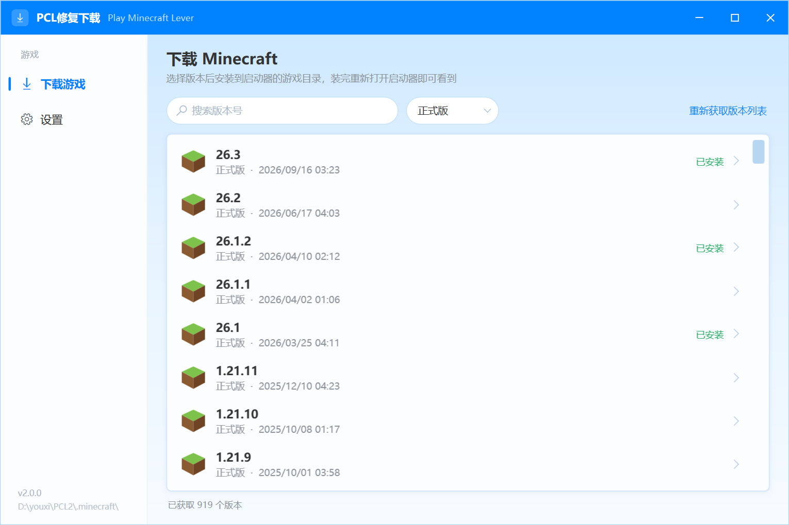
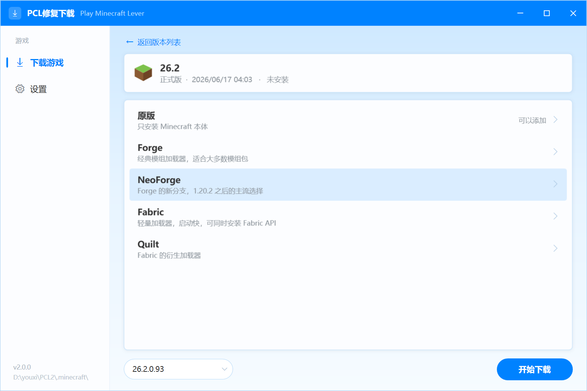
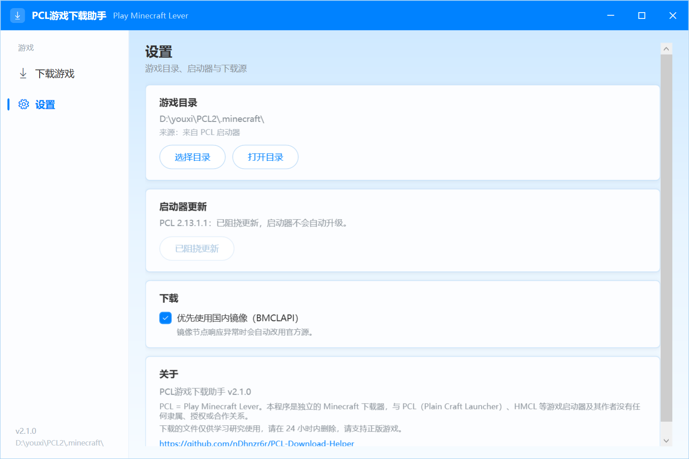

# PCL游戏下载助手

**PCL = Play Minecraft Lever**

一个独立的 Minecraft 下载器：把游戏直接装进启动器的游戏目录，并在需要时阻挠启动器自动更新。

> ### ⚠️ 使用前请了解
>
> - 本程序是个人开发的第三方工具，**与 PCL（Plain Craft Launcher）、HMCL 等游戏启动器及其作者没有任何关系**，也没有获得任何授权或认可。
> - 名称中的 **PCL** 指 **Play Minecraft Lever**，不是 Plain Craft Launcher 的缩写。
> - 程序下载的文件来自 Mojang 官方服务器或公开镜像，**仅供学习和研究使用，请在 24 小时内删除**。
> - 请支持正版 Minecraft，通过官方渠道购买游戏。
> - 使用本程序产生的一切后果由使用者自行承担。

**如果这个工具有用，欢迎点个 ⭐ Star**，这是对作者最大的鼓励。







## 功能

| 模块 | 说明 |
| --- | --- |
| 版本下载 | 正式版、快照、远古版本，支持搜索，实时进度、速度与取消 |
| 加载器 | Forge、NeoForge、Fabric、Quilt |
| Fabric API | 勾选后可以**自由选择版本**（列出该 Minecraft 版本所有可用的 Fabric API） |
| 游戏目录 | 自动使用 PCL 的 `.minecraft`；没有 PCL 时用 HMCL 的游戏目录；都没有则由你手动指定 |
| 下载源 | 默认优先 BMCLAPI 国内镜像，节点异常自动切回官方源 |
| 完整性 | SHA-1 与文件大小校验，已存在的文件跳过，只补缺失部分 |
| 阻挠更新 | 对可阻挠的 PCL 一键把更新提示设为关闭，避免自动升级后失去下载入口 |


## 游戏目录从哪来

程序启动时按下面的顺序决定下载位置：

1. 你上次手动选择的目录；
2. 检测到 PCL → 用 PCL 在 `Setup.ini` 里配置的游戏目录（一般是它旁边的 `.minecraft`）；
3. 检测到 HMCL → 读 HMCL 的配置（`config/launcher-settings.json`、`game-directories.json`、旧版 `.hmcl.json`），没有配置就用它旁边的 `.minecraft`；
4. 都没有 → 弹出提示，让你在「设置 → 游戏目录」里自己选。

HMCL 不需要阻挠更新，程序也不会去动它的任何设置。

## 使用

1. 运行 `PCL游戏下载助手.exe`，不需要安装。
2. 首次启动会先确认使用须知，点「我已了解并继续」。
3. 程序自动查找 PCL / HMCL 并确定游戏目录；可以随时在「设置」里换。
4. 可阻挠更新时会弹一次提示：可以选「阻挠更新」也可以选「暂不阻挠」，选完就不会再出现。
5. 在「下载游戏」里选版本 → 选加载器（和版本）→「开始下载」。
6. 装完重新打开启动器，新版本就在版本选择列表里。

## 关于「阻挠更新」

PCL 2.99 正式版移除了游戏下载入口。旧版本本身下载功能完好，只是默认会在有新版本时自动升级。
阻挠更新做的事只有一件：把 `PCL\Setup.ini` 里的 `SystemSystemUpdate` 写成 `3`（关闭更新提示），让启动器停在当前版本。

对已经是 2.99 的启动器没有可用的配置开关，这种情况直接用本程序下载游戏即可。

源码层面的对比见 [docs/pcl-download-analysis.md](docs/pcl-download-analysis.md)。

## 技术栈

- C# + WPF，目标框架 .NET Framework 4.8（Windows 10/11 自带，无需安装运行时）
- 与 PCL 使用的技术栈一致（PCL 也已经有 C# 版本，目标同样是 net48）
- 产物为单个 exe（约 880 KB），依赖库已内嵌

## 自己打包（不放心现成的 exe 就自己编）

程序没有任何联网校验、混淆或后门：全部网络请求只访问 Mojang 官方接口与 BMCLAPI 镜像，
可以在 `src/PCLDownloadHelper/Core/Net.cs`、`LoaderCatalog.cs` 里逐行核对。
如果不想直接用 Release 里的 exe，按下面几步自己编译一个。

### 1. 准备环境

- Windows 10 / 11（64 位）
- **.NET SDK 8 或更高**（只要 SDK，**不需要** Visual Studio）

安装方式任选其一：

```powershell
# 方式一：winget
winget install Microsoft.DotNet.SDK.8
```

```powershell
# 方式二：官方安装包
# 打开 https://dotnet.microsoft.com/download 下载 ".NET SDK 8.0" 的 Windows x64 安装包
```

装完**重新打开一个终端**，确认能输出版本号：

```powershell
dotnet --list-sdks
```

> 如果 `dotnet` 报错或列不出 SDK，说明只装了运行时或没重启终端。

### 2. 获取源码

```powershell
git clone https://github.com/nDhnzr6r/PCL-Download-Helper.git
cd PCL-Download-Helper
```

想编出和某个 Release 完全一致的版本，先切到对应标签：

```powershell
git checkout v2.1.0
```

### 3. 编译

```powershell
# 推荐：脚本会自动编译并把结果放到 dist 目录
powershell -ExecutionPolicy Bypass -File build.ps1
```

```powershell
# 或者直接调用 dotnet build
dotnet build src\PCLDownloadHelper\PCLDownloadHelper.csproj -c Release
```

### 4. 产物

| 方式 | 位置 |
| --- | --- |
| `build.ps1` | `dist\PCL游戏下载助手.exe` |
| `dotnet build` | `src\PCLDownloadHelper\bin\Release\net48\PCLDownloadHelper.exe` |

产物是**单个 exe，约 876 KB**，不需要附带任何 DLL（Newtonsoft.Json 已作为内嵌资源打进 exe，
运行时由 `App.xaml.cs` 里的 `AssemblyResolve` 加载）。

### 5. 确认是你要的那个版本

- 右键 exe → 属性 → 详细信息：「产品名称」应为 **PCL游戏下载助手**，「文件版本」应为 **2.1.0.0**
- 或者直接双击运行，首次启动会先弹出使用须知
- 参考大小：官方 Release 的 exe 是 **896,512 字节**（不同 SDK 版本编译结果会有几十字节差异，属正常）

### 6. 常见问题

| 现象 | 原因 / 处理 |
| --- | --- |
| `dotnet` 不是内部或外部命令 | SDK 没装，或装完没有重开终端 |
| `NETSDK1045` / 找不到 net48 | SDK 太旧，装 .NET SDK 8 或更高 |
| 编译报找不到 `Newtonsoft.Json` | 直接调用了 `csc`；请用 `dotnet build`，会自动还原 NuGet 包 |
| 想改 exe 名字或图标 | 改 `PCLDownloadHelper.csproj` 的 `AssemblyTitle`、`Product`、`ApplicationIcon`，以及 `build.ps1` 里的输出文件名 |

> 源码以 GPL-3.0 发布，你可以自己编译、修改并再分发，只需保留同样的许可证。

## 目录结构

```
src/PCLDownloadHelper/
  Core/
    PclInstall.cs      PCL 定位、版本识别、Setup.ini 阻挠更新
    HmclInstall.cs     HMCL 定位与游戏目录解析
    SetupIni.cs        Setup.ini 读写（保留键序与换行）
    Net.cs             下载客户端：镜像回退、重试、卡死回收、SHA-1 校验
    McMeta.cs          版本元数据：规则、依赖库、资源索引
    Installer.cs       安装流程与原版 / 加载器安装
    LoaderCatalog.cs   各加载器与 Fabric API 的版本列表、安装包地址
    JavaRuntime.cs     查找本机 Java，供 Forge / NeoForge 安装程序使用
  UI/                  主窗口、提示框、列表模型
assets/                图标
docs/                  截图与源码分析
```

## 已知限制

- OptiFine、LiteLoader 暂未支持：它们的安装程序只有图形界面，需要额外做无界面注入。
- Forge / NeoForge 安装需要本机已有 Java；Fabric、Quilt 只需要下载文件。
- 只负责把文件放到位，账号登录、Java 版本选择、启动参数仍由启动器负责。

## 许可

GPL-3.0（GNU General Public License v3.0），完整条款见 [LICENSE](LICENSE)。